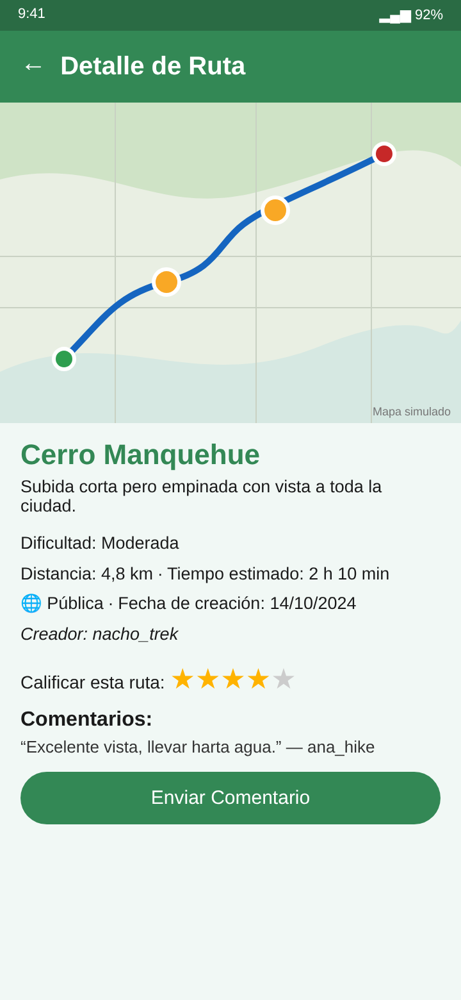

# iTrek (API)

API REST en **Django + Django REST Framework** de [iTrek](https://github.com/ignaciovillela/iTrek-front), una app móvil para registrar, compartir y calificar rutas de trekking.

> Proyecto personal desarrollado entre **septiembre y diciembre de 2024** (35 commits).



*Maqueta de la pantalla de detalle de la app, que consume esta API.*

## Qué hace

- **Usuarios**: registro con **confirmación por email** (plantillas HTML de bienvenida y confirmación), login por token, cambio de contraseña, edición de perfil con foto, búsqueda y eliminación de cuenta.
- **Rutas**: CRUD con trazado de puntos GPS ordenados, **puntos de interés** (descripción + imagen), dificultad, distancia y tiempo estimado; públicas o privadas.
- **Social**: **compartir** una ruta con otro usuario, **valorar** (estrellas, con puntaje promedio) y **comentar**. Página web pública para compartir una ruta (`/share/route/<id>/`).
- **Gamificación**: niveles y puntos calculados a partir de días en la plataforma, distancia, tiempo y estrellas recibidas.
- **Actividad** del usuario con opción de borrar elementos.

## Endpoints principales

| Prefijo | Acciones |
|---|---|
| `/api/auth/` | `login`, `logout`, `check-login` (datos y nivel del usuario) |
| `/api/users/` | `create`, `confirm-email/<token>`, `update-profile`, `change-password`, `delete-account`, `search`, `actividad` |
| `/api/routes/` | CRUD de rutas, `POST/DELETE <id>/share/<usuario_id>/`, `POST <id>/rate/`, `GET/POST <id>/comment/` |

## Modelo de datos

`Usuario` (email único, biografía, imagen) · `Ruta` · `Punto` → `PuntoInteres` · `RutaCompartida` · `Comentario` · `Puntaje`.

## Ejecutar

```bash
python -m venv .venv && source .venv/bin/activate
pip install -r requirements.txt
cp .env.example .env        # completar SECRET_KEY y, opcionalmente, el SMTP
python manage.py migrate
python manage.py runserver
```

Stack: Django 5.1 · DRF 3.15 · django-rest-authtoken · drf-extra-fields · Pillow · SQLite.
